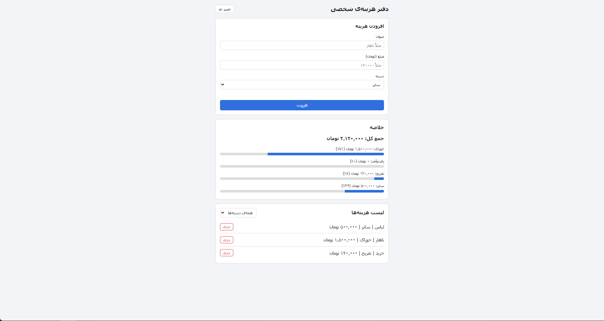
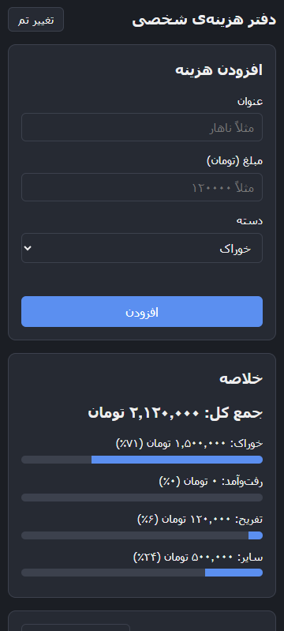

# دفتر هزینه‌ی شخصی

یک وب‌اپ ساده برای ثبت هزینه‌های روزانه که با HTML، CSS و JavaScript خالص (بدون فریم‌ورک) ساخته شده است.

🔗 **دمو:** https://efiunique.github.io/expense-tracker/

## امکانات

- افزودن هزینه با عنوان، مبلغ (تومان) و دسته (خوراک، رفت‌وآمد، تفریح، سایر)
- حذف هر هزینه از لیست
- نمایش جمع کل و جمع هر دسته با جداکننده‌ی هزارگان (مثل ۱٬۲۵۰٬۰۰۰)
- نمودار ساده‌ی درصد هر دسته (با CSS)
- فیلتر لیست بر اساس دسته
- ذخیره‌ی اطلاعات در `localStorage` (بعد از رفرش پاک نمی‌شود)
- اعتبارسنجی فرم (عنوان خالی یا مبلغ نامعتبر پیام خطا می‌دهد)
- امکان وارد کردن مبلغ با اعداد فارسی
- حالت تاریک
- راست‌چین و ریسپانسیو برای موبایل

## اجرا

نیازی به نصب چیزی نیست:

1. ریپو را کلون کنید:
   ```bash
   git clone https://github.com/efiunique/expense-tracker.git
   ```
2. فایل `index.html` را در مرورگر باز کنید.

## ساختار فایل‌ها

```
index.html   ساختار صفحه
style.css    استایل‌ها، حالت تاریک و ریسپانسیو
app.js       منطق برنامه (افزودن، حذف، فیلتر، جمع‌ها، ذخیره)
```

## تصاویر

| دسکتاپ | موبایل (حالت تاریک) |
|---|---|
|  |  |
